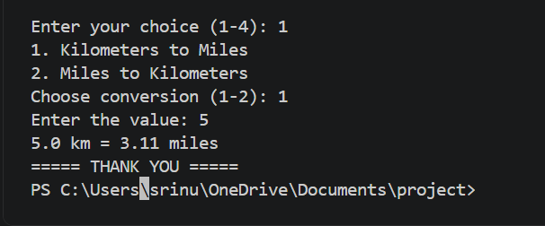
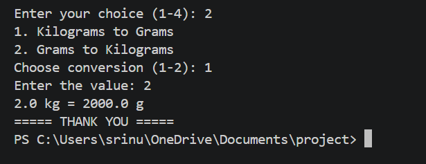
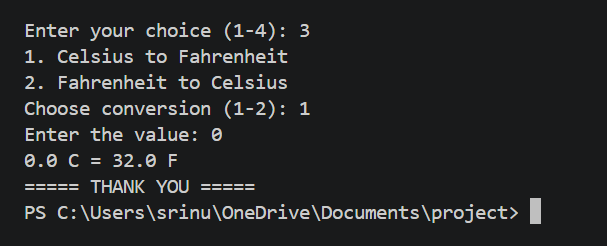
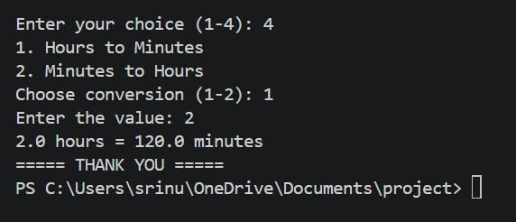
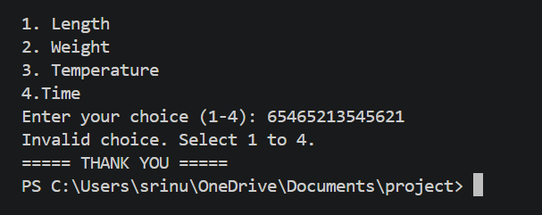

# Project Summary – Unit Conversion System

## 1. Implementation

I created this project using Python. I divided the program into four functions for Length, Weight, Temperature and Time conversions.

Each function performs the required calculation and returns the result. I used `if-elif-else` for menu selection and `try-except` to handle invalid inputs.

## 2. Difficulties Faced

Initially, I found it a little difficult to understand how functions and `return` work. I also had to figure out the correct formulas for each conversion and how to handle both conversion directions.

While working on it, I got a better understanding of these concepts.

## 3. Test Cases

I tested the program with different inputs to check whether the conversions were giving the correct results.

**1. Length Conversion**k
- Input: 5 km → Expected Output: 3.11 miles
- Input: 10 miles → Expected Output: 16.09 km
- 

**2. Weight Conversion**
- Input: 2 kg → Expected Output: 2000 grams
- Input: 500 grams → Expected Output: 0.50 kg
- 

**3. Temperature Conversion**
- Input: 0°C → Expected Output: 32°F
- Input: 212°F → Expected Output: 100°C
- 

**4. Time Conversion**
- Input: 2 hours → Expected Output: 120 minutes
- Input: 120 minutes → Expected Output: 2 hours
- 

**5. Invalid Inputs**
- Input: 7 (menu choice) → Output: Invalid choice message
- Input: abc (numerical value) → Output: Invalid value message
- 

## 4. Output

The program displays the converted value when the input is valid. For invalid choices or values, it displays an appropriate error message.

## 5. Conclusion

This project helped me understand the basics of Python functions, conditional statements, operators and exception handling through a simple practical application.
